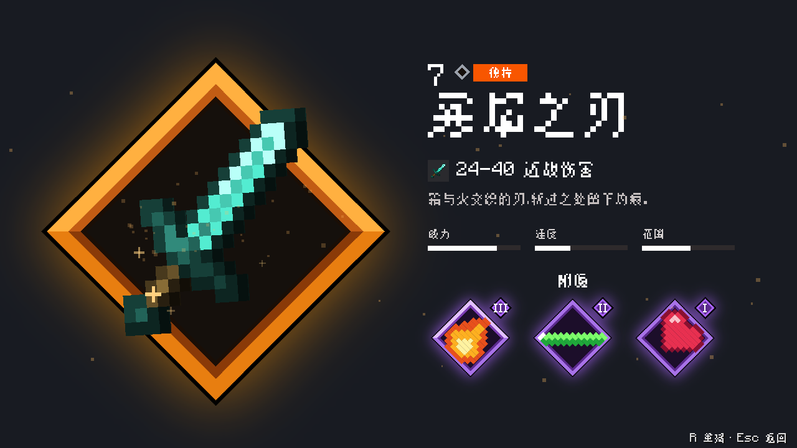
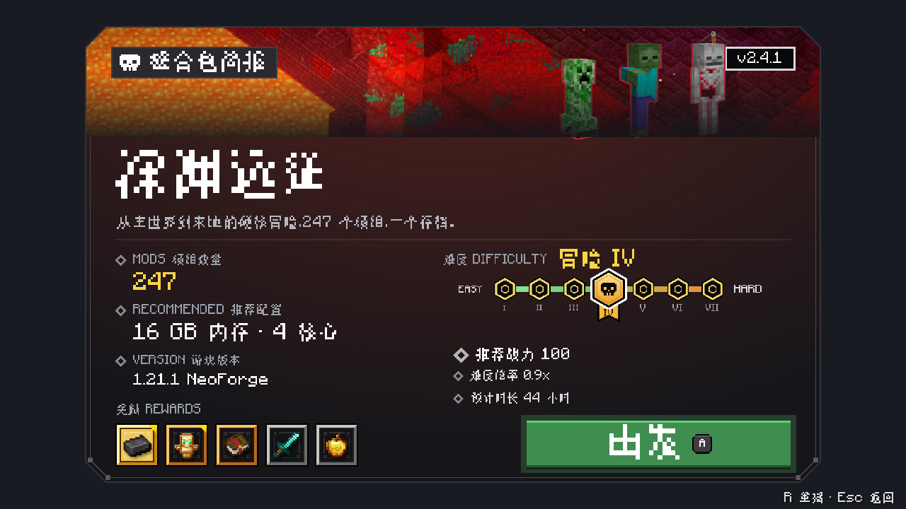
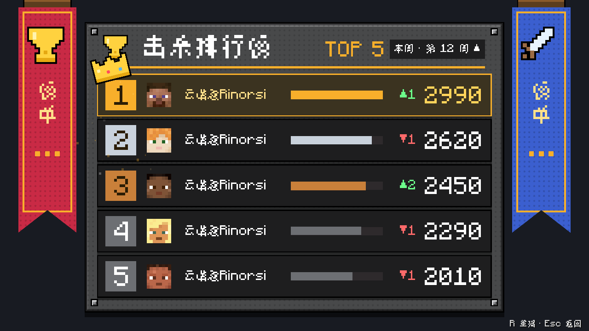
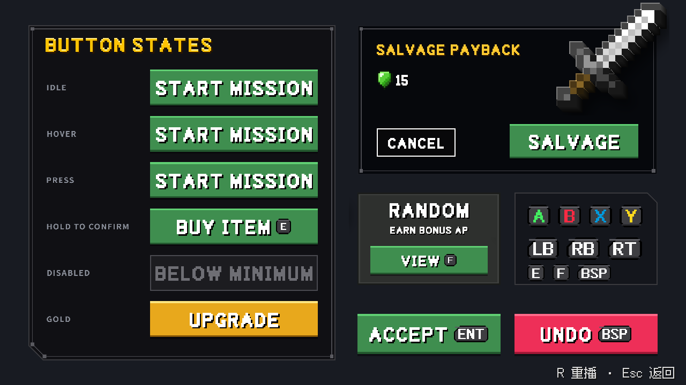

# Oriel UI（优易库）

面向 Minecraft Java 版的模组 UI 库：用类 HTML/CSS 的声明式文件写界面，引擎负责样式、排版、动画与输入，再用游戏自己的 GUI 渲染器画出来。第一套主题对齐基岩版 Ore UI 的像素斜角风格，也支持平滑圆角风格。

**当前版本：0.15**。瘦包 `0.15.0`、完整版 `0.15.1`，mod id 均为 `oriel`。0.15 新增原生文本编辑区着色、行号、关闭自动换行时的横向滚动，以及脚本选区接口，详见[更新记录](CHANGELOG.md)。

> **接入与分发必读：[瘦包 / 完整版 / Jar-in-Jar](docs/zh/distribution.md)。** 下游可嵌入瘦包或使用外部必需依赖，当前依赖范围为 `>=0.15.0 <0.16.0` / `[0.15.0,0.16.0)`；所用模板与示例复制到自己的模组。核心变化提升 minor，完整版补丁只更新参考内容。0.15 六目标双变体构建、核心配对及发行/Maven 检查已通过；游戏输入、IME 与混装的验证范围见分发指南，构建通过不代表全部实机验收。

## 界面预览

以下截图来自我们制作的官方编号 UI 模板，使用 Oriel 0.15 原生引擎预览器渲染，采用纯色背景。模板展示界面与交互效果，业务逻辑由下游模组接入。完整版中可从 `/oriel showcase` → 模板中心打开。

**物品详情**：品质边框、属性条与附魔徽章。



**关卡简报**：头图、难度选择、奖励预览与主操作。



**动态排行榜**：玩家头像、排名变化与积分条。



**关卡结算**：成绩徽章、战斗统计与资源奖励。


**基础组件**：按钮状态、键帽、确认与撤销操作。



页面源码与复用方式见[官方模板目录](docs/zh/templates.md)。

## 特点

- **写法接近网页**：HTML + CSS（块、行内、Flex、Grid、过渡、`@keyframes`、渐变、滤镜、遮罩、`clip-path`……），具体能写什么见 [CSS 支持参考](docs/zh/css-reference.md)。
- **不支持就报错**：未知属性、单位、元素、at 规则都会给出带文件和行号的诊断，不会静默忽略。
- **Minecraft 内容进页面**：`<item>`、`<slot>`（容器槽位）、`<entity>`、`<model>`、`<scene>`。
- **界面类型**：全屏/弹窗界面、HUD 叠加层、服务端驱动的界面、带物品槽的容器界面。
- **Ore 像素主题 + 平滑主题**，亮/暗两套，200 个像素图标（三种线宽）、粒子与命名动效库。**完整版另含参考内容**：首页、模板中心、组件/图标展示、showcase 与 demo；瘦包保留设置、关于、我的页面和基础层。下游所用模板与示例应[复制到自己的模组](docs/zh/templates.md#怎么复用到你的模组)。
- **文本编辑与中文支持**：原生文本框、着色与行号、脚本选区接口，CJK 断行、输入法预编辑与候选窗定位、中文字体子集；OS 输入法实测范围见[能力与限制](docs/zh/capabilities.md)。
- **为 AI 开发设计**：热重载、无头截图、页面检查、MCP 服务、游戏内自动验收。
- **版本**：Minecraft 26.1.2（主验收版本）/ 26.2 / 26.3，Fabric 与 NeoForge，Java 25。

## 文档

制作与接入从 [中文手册入口](docs/zh/index.md)开始，查 [能力与限制](docs/zh/capabilities.md)、[完整流程](docs/zh/ui-workflow.md)、[Java API](docs/zh/java-api.md)。能力修改须同步 [维护合同](docs/zh/maintainers/maintenance.md)。

从 [docs/zh/index.md](docs/zh/index.md) 开始：

| | |
|---|---|
| [实现原理](docs/zh/maintainers/architecture.md) | 模块、一帧如何画出来、与 Vellum 的关系 |
| [分发指南](docs/zh/distribution.md) | 两种分发方式、瘦包/完整版、版本规则、依赖片段与嵌套提示 |
| [接入指南](docs/zh/integration.md) | 依赖、打开页面、HUD、服务端、容器 |
| [服务端篇](docs/zh/server.md) | 什么界面需要服务端、数据怎么流、谁负责校验 |
| [CSS 支持参考](docs/zh/css-reference.md) | 属性、选择器、函数的支持情况（由引擎生成） |
| [做一个新页面](docs/zh/ui-workflow.md) | 脚手架、页面结构、控制器 |

## 构建

需要 JDK 25 与 git（构建时会下载 Rhino 源码并打补丁）。

```bash
./gradlew build -Poriel_slim
```

上面构建瘦包；Maven 发布只允许瘦包。给玩家的完整版使用 `./gradlew assemble -Poriel_release`。发布前按[检查清单](docs/zh/distribution.md#6-发布前检查清单)逐目标核验，不能把默认开发构建当作已验收的分发包。

## 运行演示

```bash
./gradlew :fabric:26.1:runClient
```

使用完整版进入世界后在聊天栏输入 `/oriel showcase` 打开首页，`/oriel showcase catalog` 看组件与动效目录。

## 开发

参与维护、反馈问题与提交前验证见 [贡献指南](CONTRIBUTING.md)。

```bash
node tools/new-page.mjs <名字> "<标题>"      # 新页面：HTML + 控制器 + 测试 + 登记
./gradlew :kit:test :preview:checkUi          # 测试 + 全部页面无头检查
node tools/mcp/oriel-preview.mjs              # MCP 服务（检查、截图、交互）
```

## 许可证

MIT。包含 Vellum 的部分保留其版权声明；内置的 Mozilla Rhino（MPL-2.0）、字体（SIL OFL）等第三方内容见 [NOTICE](NOTICE)。

基于 [Vellum](https://github.com/MaxLeiter/vellum)（MIT，Max Leiter）开发，感谢原作者。
