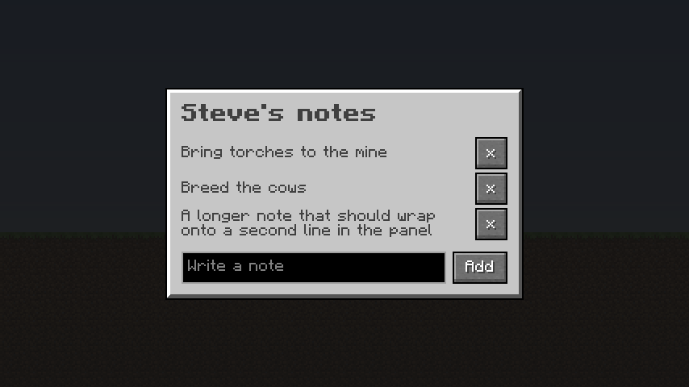

# Oriel mod 模板

**先读[分发指南：瘦包 / 完整版 / Jar-in-Jar](../docs/zh/distribution.md)。** 模板已改用 0.12 元数据范围，仓库 `templateCompile` 已用瘦包编译两个加载器模板；复制出去的工程与真实游戏运行仍未验证。选择嵌入瘦包或外部必需依赖后再发布。

默认选外部必需依赖：玩家另装 Oriel，下游包更小、库可独立更新；希望只发一个下游 jar 时选 `-PorielEmbedded=true`。Editor 实测约 1.17 MB（外部）/ 11.07 MB（嵌入），不代表所有模组体积。互转保留同一 mod id、API 与必需依赖范围，只切换构建开关及平台的独立 Oriel 依赖声明；配置保留性**未验证**。详细比较、专服 12/12 的实际范围及旧副本限制见[怎么选、怎么互转](../docs/zh/distribution.md#1-两种分发方式)。

模板不会自动转译 H5，也不会替业务生成权限校验与菜单。开发见[制作流程](../docs/zh/ui-workflow.md)、[Java API](../docs/zh/java-api.md)，完成后按[验收工具](../docs/zh/validation.md)验证。

两个小 mod 可供起步，一个 NeoForge、一个 Fabric，面向 Minecraft 26.3。每个都加了一个 `/notes` 命令，打开一个笔记页面：mod 把你的笔记交给页面，页面把你的增删发回来。



## 开始一个 mod

复制你的加载器对应的文件夹：

```bash
cp -R template/neoforge my-mod
```

（或 `template/fabric`）。然后在 `my-mod` 里：

1. 在 `gradle.properties` 里设置 `mod_id`、`mod_name`、`mod_group_id` 等。
2. 把包 `com.example.examplemod` 和文件夹 `assets/examplemod` 改成对应的名字。在 NeoForge 上，`ExampleModClient` 里的 `MOD_ID` 也要一致。
3. `./gradlew runClient`，进入一个世界，输入 `/notes`。

在 macOS 上，如果客户端在第一帧卡住，在 `runs/client/options.txt` 里加 `enableVsync:false`。

## 里面有什么

- `src/main/resources/assets/examplemod/oriel/notes.html` 是页面：HTML、CSS 和一个 Vue 风格模板，加几行脚本。
- `Notes.java` 带着数据打开页面，并处理它发来的消息。
- `ExampleModClient.java` 注册 `/notes`。
- `build.gradle` 从本仓库的 `build/template-maven` 或 `mavenLocal()` 获取 Oriel。在仓库里运行 `./gradlew templateCompile -Poriel_slim`，会把当前工件发布到私有构建目录并编译两个模板。对复制出去且默认使用瘦包 `0.12.0` 的工程，请在本仓库运行 `publishToMavenLocal -Poriel_slim`，或传 `-PorielRepository=<含该版本的本地仓库>`。没有仓库、只有 jar 时见[只有 jar 时的最小 Fabric 工程](../docs/zh/quickstart.md)。
- 当前模板默认依赖瘦包 `0.12.0`，且 **`orielEmbedded=false`（外部必需依赖）**：下游 jar 较小，玩家可从官方渠道单独更新库。`./gradlew build -PorielEmbedded=true` 使用 Fabric include / NeoForge jarJar 嵌入瘦包；`-PorielEmbedded=false` 切回外部，省略也为 false。仅接受 `true/false`；`oriel_version` 必须为 `0.12.0`。两种模式文件名相同，分别保存发行产物。范围始终为 Fabric `>=0.12.0 <0.13.0`、NeoForge `[0.12.0,0.13.0)`，也接受玩家安装的完整版 `0.12.1`。0.12 起核心任何改动都升 minor；完整版补丁只改参考内容。两种模式的编译依赖都固定为瘦包 `X.Y.0`，不要改为完整版；Maven（含 MavenLocal 和模板私有仓库）只允许发布瘦包，不带 `-Poriel_slim` 的发布/模板编译直接报错，完整版只通过 Modrinth / CurseForge / dist 分发 jar。
- loader 工件已自包含 Oriel 模块，因此模板的 implementation/include/jarJar 都禁用传递解析；Fabric API 仍由模板单独声明。Fabric include 与 NeoForge JarJar 分别设置严格范围 `[0.12.0,0.13.0)` 和优先版本 `0.12.0`，解析后均核验实际版本；旧镜像或额外约束选到 full 时拒绝打包。Fabric 的 include 配置独立于 implementation，不能省略它自己的版本约束。Fabric 对 include 任务显式跟踪开关，支持同目录外部→嵌入→外部切换。
- `jijAcceptance` 是专服验收专用属性，优先于 `orielEmbedded`：Oriel 只作 compileOnly，不内嵌，由验收工具在 `jijRunDir` 的 mods 中准备真实父包。普通下游构建不要传此属性。
- `neoforge.mods.toml` 或 `fabric.mod.json` 把 Oriel 设成必需依赖。玩家像装其他 mod 一样安装它，如果你在 Modrinth 和 CurseForge 页面上把它列为必需依赖，启动器会替他们装。想只发一个 jar，传 `-PorielEmbedded=true`，详见[分发配方](../docs/zh/distribution.md#4-gradle-与加载器元数据)；NeoForge 的 JarJar 清单与 TOML 都要声明范围。所用模板、showcase、demo 及相关资源复制到自己的命名空间，不依赖完整版恰好存在。

`runClient` 运行期间，保存 `notes.html` 会重载打开的页面，不用重启游戏就能改。[预览器](../preview/README.md)可以完全不启动 Minecraft 就显示页面。

## 下一步

- [页面接口](../docs/zh/pages.md)：数据、消息、从服务器打开页面。
- [容器页面](../docs/zh/containers.md)：带真实槽位的物品栏。
- [脚本](../docs/zh/scripting.md)：JavaScript 和模板。
- [全部文档](../docs/zh/index.md)
